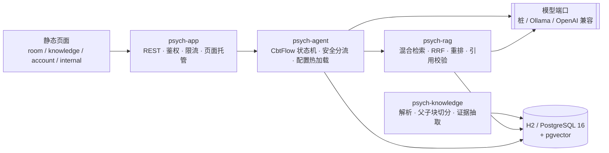
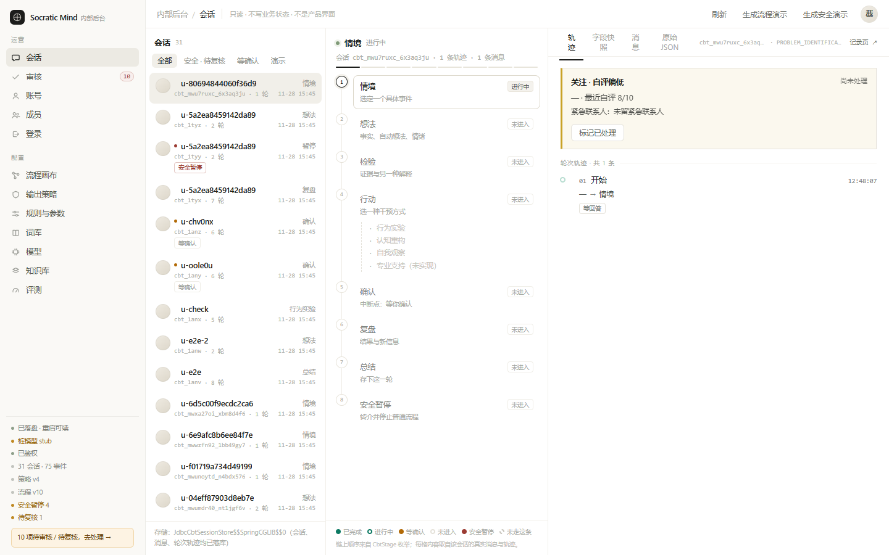
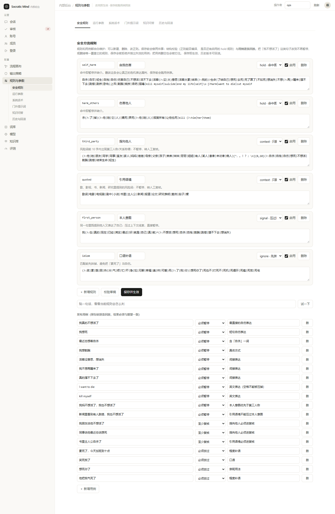
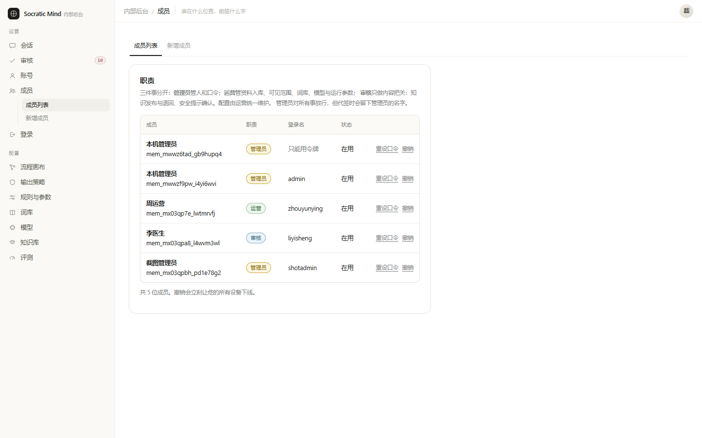

# Socratic Mind

**把 CBT 自助练习做成"确定性骨架 + 受控生成"的可私有化实现。**

流程由代码推进，模型只在被允许的位置说话。知识问答的每条结论都能指回证据；
CBT 的每一步都能说清走到哪、谁确认过。

`v0.7.0` · Java 21 / Spring Boot 3.5 · H2 或 PostgreSQL 16 + pgvector · 212 项测试通过 · 未上线


*入口是一间房间，不是聊天列表。点墙角的小人开口，说完的话变成纸片飞出窗外；地上五颗石子表示走到第几步。
墙角那扇门通向"门外"——没有步骤，只有一来一回。*

## 它是什么

两个工作流和一扇门，共用一个经过审核的心理知识库：

| 工作流 | 做什么 | 关键约束 |
|-|-|-|
| **知识学习** | 回答心理学与治疗理论问题，每条结论附出处 | 证据不足时明确拒答，不补全 |
| **CBT 自助** | 围绕一个具体困扰走完"情境 → 自动思维 → 认知检验 → 微型行动 → 复盘" | "确认"必须由用户自己按下 |
| **门外** | 没有步骤的直接对话，想从哪句开始都行 | 安全筛查一轮不跳；不诊断、不劝、不承诺疗效 |


*走出门之后没有阶段、没有石子，只有天空和一条输入框。安全筛查与提示词边界与屋里同一套，触发时同样停在转介页。*

## 它不是什么

| 不是 | 原因 |
|-|-|
| 不是聊天机器人 | 聊天优化"说得像不像人"；这里优化"这句话有没有出处、用户走到第几步、这句该不该说" |
| 不是诊断工具 | 不推断精神障碍、不给药物或治疗建议。声明疗效即进入医疗器械监管 |
| 不是多 Agent | 知识集中在一套审核过的文档里，复杂度该花在证据质量与状态可控上 |
| 不是低代码平台拼得出来的 | 平台把会话建模成消息历史；这里需要可暂停、可确认、可回滚的业务状态机 |

## 快速开始

### Docker（推荐）

Windows 双击根目录 `start.cmd`：生成 `.env` → 构建镜像 → 起 PostgreSQL/pgvector → 等健康检查 → 打开房间。
停止双击 `stop.cmd`（连同 Docker 的 WSL 虚拟机一起关闭，`vmmem` 内存会释放）。

命令行等价写法：

```bash
bash scripts/stack.sh up          # Git Bash / WSL / Linux / macOS
```

```powershell
powershell -ExecutionPolicy Bypass -File scripts\stack.ps1 up   # Windows 原生终端
```

数据落在命名卷里：`down` 不丢，`reset` 才清空。首次启动会打印后台账号 `admin` 与写入 `.env` 的口令。

**默认不启动模型**：容器档用桩模型（哈希向量，零成本），断网也能跑通两个流程。要真模型加 `--ai`
（Windows：`start.cmd ai`），会再起一个 Ollama 容器并拉取 `bge-m3` 与 `qwen3-8b`。
国内拉不动镜像时，在 `.env` 里设 `DOCKER_MIRROR=docker.m.daocloud.io`。细节见 [deploy/README](deploy/README.md)。

### 本机 jar（没有 Docker 时）

```bash
cd backend
mvn -o package

export PSYCH_USER_SECRET="换成你自己的随机串，至少 16 字节"
export PSYCH_INTERNAL_TOKEN="dev-internal-token"

java -jar psych-app/target/psych-app-0.7.0.jar \
  --server.port=8099 --spring.profiles.active=h2        # 默认接本机 Ollama
# 没有 Ollama 只想看流程：--spring.profiles.active=h2,stub
```

`h2` 档默认连本机 Ollama（`qwen3-8b` + `bge-m3`，1024 维）；`h2,stub` 零依赖、可离线。

### 入口

| 地址 | 是什么 |
|-|-|
| <http://localhost:8099/room/> | 产品界面（CBT 对话；墙角有门，出去是"门外"自由对话） |
| <http://localhost:8099/knowledge/> | 用户知识问答（纸本阅读风格） |
| <http://localhost:8099/account/> | 账号：注册、登录、退出（可选，不登录也能用） |
| <http://localhost:8099/internal> | 内部控制台：会话轨迹、待复核队列 |
| <http://localhost:8099/internal/settings.html> | 规则与参数、系统话术、版本回滚 |

后台其余页面（知识库、词库、画布、策略、评测、审核、账号视图）见 [内部后台](docs/03-设计/03-内部后台.md)。

## 架构



> **实际栈与 ADR 的偏差，文档里说清楚**：目标栈是 Spring AI Alibaba Graph，但当前实现是**手写的
> `CbtFlow` 状态机**（Java 21 + Spring Boot），没有引入 Spring AI 与 Graph 框架；模型与存储都通过端口隔离。
> 偏离原因、回补条件记在 [ADR-0002](docs/04-adr/ADR-0002-Java栈与Graph选型.md) 的备注里。

四层各管一件事，越界即设计错误：

| 层 | 只负责 | 不负责 |
|-|-|-|
| 页面 | 呈现、输入、交互 | 决定流程走向、拼装状态 |
| 应用层 | 身份、会话、接口、权限、审计 | 心理学结论、检索策略 |
| 流程与检索 | 节点编排、条件路由、中断恢复、证据组装 | 直接生成证据、决定该不该说 |
| 存储 | 状态与事实的持久化 | 业务判断 |

一句话原则：**流程由代码推进，证据来自知识库，状态存在数据库，模型只负责理解与改写。**

## 四个设计选择

**1. 流程不交给模型。** 阶段推进由代码与配置决定，模型只在"改写想法""生成总结"两处被调用。
改一条分支不用改代码，改 `config/flows/` 里的定义即可，发布前有结构校验。

**2. 不做无据生成。** 先检索、再生成、再校验引用；检索不到就返回"资料不足"，这是正常结果。
模型自己说"资料不足"时，状态也会改判为拒答——不靠提示词自觉。

**3. 规则、话术、限流都能改，但改不坏。** 后台可增删安全规则、改系统话术、调限流；
保存前跑固定用例回放，把"我不想活了"改成不再暂停会被拒绝；每次保存留快照，可回滚。

**4. 心理记录默认拿不走。** 会话归属用服务端签发的匿名令牌，不属于你的会话一律表现为"不存在"，
id 也不是自增序号。不注册就能完整使用；账号是自愿的叠加层——只扩大"能看哪些记录"，
不改写"这一轮属于哪台设备"（[ADR-0009](docs/04-adr/ADR-0009-账号作为叠加层.md)）。

## 一次对话长什么样

```
情境   最近有什么事一直搁在心里？
想法   那个时刻，你脑子里冒出来的第一句话是什么？
检验   我们把它当成一个预测，而不是事实。有没有出现过不一样的情况？
行动   最小的一步可以是什么？        ← 计划里出现"写/试/做"会追问执行细节
确认   把改写后的说法与计划复述给你，等你确认   ← 中断点，普通消息推不动
复盘   后来实际发生了什么？
总结   存下这一轮
```

任何一步命中安全规则，流程立即停在转介页，给出你所在地区的急救与心理援助路径（不写死号码），后续消息不会把对话拉回普通流程。

用户侧还有四件事，都是为了"把话说出来"和"知道有没有变好"：**语音输入**（Chrome/Edge 浏览器内转写，
Firefox 走本机转写、不落库）、**情绪刻度**（自己点 0–10，单轮折线、窗外 30 天）、
**危机卡片**（当地求助路径 + 自留联系人 + 一段可复制的求助话，系统不代发；联系人可在登录后的账号页先填好）、**偏差提示**（候选，不是诊断）。

记录可以带走，但只在本人同意时：一次性链接，24 小时过期、只能打开一次、本人可撤回，不含联系人电话。

## 代码结构

```
backend/
├── psych-common          领域模型 + 端口（ChatPort / EmbeddingPort / CbtSessionStore …）
├── psych-session         会话状态、消息、逐轮轨迹
├── psych-knowledge       Markdown 解析、父子块切分、证据抽取
├── psych-rag             混合检索、RRF、重排、引用校验、提示词
├── psych-agent           CbtFlow、安全分流、流程/规则/参数配置
├── psych-infrastructure  存储实现（内存 / JDBC）、模型适配（桩 / HTTP）、输出闸门
└── psych-app             启动入口、REST、页面、种子数据
```

依赖单向：`app → agent / infrastructure → knowledge / rag / session → common`。
`rag` 不依赖 `agent`，换库或换模型只改 `infrastructure` 里的适配器。详见 [模块与技术栈](docs/02-架构/01-模块与技术栈.md)。

## 后台



左栏是会话（含"待复核"标记），中间是这一轮走过的节点与分支，右侧是每轮用了哪条路、多久、是不是模板兜底。



规则与用例都可增删；保存前逐条回放用例，失败会指出哪一句不再符合预期。每次保存留快照，可对比、可回滚。



后台分四种职责：管理员、运营、审核、只读。入库、改配置、签字、管成员各归各的；会话原文默认只给管理员，
审核者只能看已进入安全流程的会话。成员与口令在“运营 → 成员”里由管理员当面设定；撤销会立刻让该成员所有设备下线。

## 当前状态

- **已实现**：两个工作流与门外自由对话、审核知识库、安全分流与转介、可选账号、记录导出与一次性分享、
  后台可配置与回滚、四类职责分离与成员管理、提示词可运营、容器化一键启动；`mvn -o test` 212 项通过，
  H2 档与容器档均实跑。
- **只在小样本上验证**：真实模型仅 CPU 跑过（34 条正式集），单轮 30–60 秒；安全集 25 条、流程集 8 条。
- **明确未做**：临床审核签字、邮箱验证、真人兜底、跨会话疗程、PHQ-9 等量表、GPU/云端成本对比。

完整清单见 [版本记录 §当前边界](docs/06-评估/01-版本记录.md#当前边界)。

## 文档

| 想了解 | 先读 |
|-|-|
| 为什么是这个形态 | [产品与边界](docs/01-概览/01-产品与边界.md) → [方案对比](docs/01-概览/03-方案对比.md) |
| 接手代码 | [总体架构](docs/01-概览/02-总体架构.md) → [模块与技术栈](docs/02-架构/01-模块与技术栈.md) → [接口契约](docs/02-架构/05-接口契约.md) |
| 改流程或规则 | [流程与状态](docs/02-架构/02-流程与状态.md) → [CBT 状态机](docs/03-设计/01-CBT状态机.md) → [安全与转介](docs/03-设计/02-安全与转介.md) |
| 上线与运维 | [内部后台](docs/03-设计/03-内部后台.md) → [deploy/README](deploy/README.md) |
| 看证据与取舍 | [版本记录](docs/06-评估/01-版本记录.md) → [评估与测试集](docs/06-评估/02-评估与测试集.md) |
| 全部文档 | [docs/README](docs/README.md)（一页地图） |

## 边界与许可

本项目不是医疗器械，不提供诊断、治疗或用药建议。它做的是把 CBT 里可自助的部分结构化，
并在识别到风险时把人导向专业帮助。示例语料仅供开发验证，不可作为临床依据。

代码以 [MIT 协议](LICENSE) 发布：可自由使用、修改、分发，保留版权与许可声明即可。
第三方依赖各自遵循其许可证；示例语料只用于开发验证。
