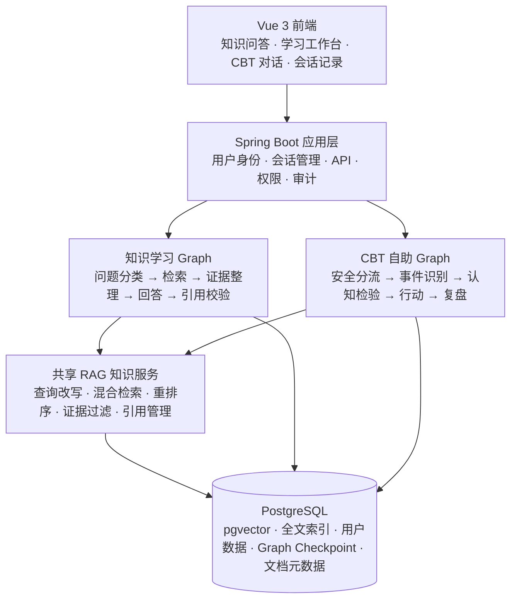

# 第 1 章 产品边界与总体架构

## 1.1 技术形态

第一版采用 **Java 单体后端 + Spring AI + Spring AI Alibaba Graph + PostgreSQL/pgvector**。

这不是"技术偏好"的结果，而是三条约束的交点：需要确定性状态机（排除纯提示词方案）、需要证据可溯源（排除仅靠模型记忆）、需要可私有化部署（排除 SaaS 平台依赖）。取舍过程见 [第 2 章](02-相关方案横向对比.md)，选型记录见 [ADR-0002](../03-adr/ADR-0002-Java栈与Graph选型.md)。

## 1.2 产品边界

先把边界定清楚，边界先于技术。

| 做 | 具体含义 |
|-|-|
| **心理知识科普与学习** | 回答心理学、心理健康、心理治疗理论相关问题，提供出处和学习路径 |
| **CBT 自助 Agent** | 围绕一个具体困扰，进行情境识别、自动思维提取、认知检验、微型行动和复盘 |
| **不做** | **临床诊断与治疗决策**：不推断用户患有什么精神障碍，不给出药物或临床治疗指令 |

"暂不做"不是保守，是定价结构决定的：在没有支付方的市场里，"当工具卖"是唯一不需要牌照和临床证据的位置。推导见 [§2.4.3](02-相关方案横向对比.md)，决策记录见 [ADR-0004](../03-adr/ADR-0004-产品边界停在不诊断.md)。

## 1.3 范围裁剪：为什么不是多 Agent

第一版**不需要三个独立 Agent，也不需要 GraphRAG**。

做成两个业务工作流，共享一个经过审核的心理知识 RAG 服务：

- **KnowledgeGraph** —— 知识问答、科普、学习。
- **CbtGraph** —— 结构化 CBT 自助练习。

理由只有一条：多 Agent 与 GraphRAG 解决的是"知识分布在多个主体、需要协商"的问题；本项目的知识集中在一套审核过的文档里，复杂度应该花在**证据质量**和**状态可控**上，而不是花在 Agent 之间的对话上。这也直接对应延迟预算（首 token P95 < 1.5s，见 [§2.2.1](02-相关方案横向对比.md)）。

## 1.4 总体架构

四层各管一件事，越界即设计错误：

| 层 | 只负责 | 不负责 |
|-|-|-|
| 前端 | 呈现、输入、流式渲染 | 决定流程走向、拼装 State |
| 应用层 | 身份、会话、API、权限、审计 | 心理学结论、检索策略 |
| Graph | 节点编排、条件路由、中断与恢复 | 管数据库事务、直接生成证据 |
| RAG 服务 | 检索、过滤、证据组装、引用定位 | 决定 CBT 流程 |
| 数据库 | 状态与事实的持久化 | 业务判断 |

## 1.5 架构原则

> **Graph 负责流程，RAG 负责证据，数据库负责状态和事实，LLM 负责理解与生成。**

由此推出三条禁令：

1. **不要让 LLM 自己决定所有业务状态。** 走到第几步、用户确认了什么，必须是显式字段，不是"模型记得"。
2. **不要让 RAG 检索结果直接成为诊断结论。** 检索到的是"干预知识依据"，不是"该用户应该做什么"。
3. **不要让检索动作都走 LLM。** 检索、融合、引用定位是确定性代码；模型只用在理解与生成上。节点级分工见 [§5.2](05-双Graph设计.md)。

## 1.6 本章对应的决策

| 决定 | ADR |
|-|-|
| Java 模块化单体 | [ADR-0001](../03-adr/ADR-0001-模块化单体而非微服务.md) |
| Spring AI + Spring AI Alibaba Graph | [ADR-0002](../03-adr/ADR-0002-Java栈与Graph选型.md) |
| 边界停在"不诊断" | [ADR-0004](../03-adr/ADR-0004-产品边界停在不诊断.md) |
| 两个 Graph 独立 State | [ADR-0005](../03-adr/ADR-0005-双Graph独立State.md) |

下一章：[第 2 章 相关方案横向对比](02-相关方案横向对比.md)
