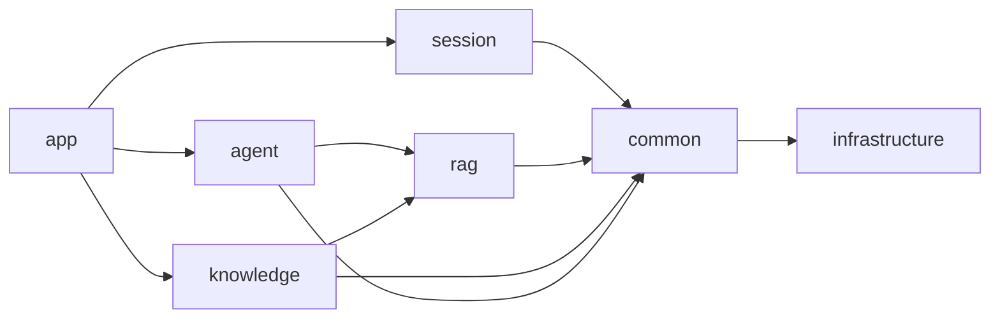

# 第 3 章 模块拆分

## 3.1 为什么是模块化单体

建议采用**模块化单体（Modular Monolith）**，先不要拆微服务。

| 维度 | 单体 | 微服务 |
|-|-|-|
| 部署与调试 | 一个进程，一次启动 | 需要编排、服务发现、链路追踪 |
| 事务 | 本地事务即可保证会话与消息一致 | 跨服务最终一致，复杂度陡增 |
| 拆分成本 | 边界清楚时可按包外迁 | 边界没想清楚就拆，等于把错误固化 |
| 当前负载 | 单机足以支撑 | 无收益 |

结论：先按模块划清边界，等负载或团队规模真的需要时再拆。决策记录见 [ADR-0001](../03-adr/ADR-0001-模块化单体而非微服务.md)。

## 3.2 Maven 多模块

```
psych-assistant/
├── psych-app/                  # Spring Boot 启动入口
├── psych-common/               # 通用对象、异常、枚举
├── psych-user/                 # 用户、身份、权限
├── psych-session/              # 会话、消息、对话记录
├── psych-knowledge/            # 知识库管理、文档管理
├── psych-rag/                  # 检索、重排、引用、证据组装
├── psych-agent/                # Graph 工作流
│   ├── knowledge/              # 知识学习 Graph
│   ├── cbt/                    # CBT 自助 Graph
│   └── prompt/                 # 中文提示词
├── psych-evaluation/           # RAG 和 Agent 评估
└── psych-infrastructure/       # PostgreSQL、Redis、文件存储
```

## 3.3 模块职责与禁区

每个模块的职责要明确，**"不应该负责"这一列比"负责"更重要**：

| 模块 | 主要职责 | 不应该负责 |
|-|-|-|
| knowledge | 文档上传、审核、版本管理 | 直接生成答案 |
| rag | 检索、证据过滤、引用 | 决定 CBT 流程 |
| agent | 节点编排、条件路由 | 自己管理数据库事务 |
| session | 会话、消息、用户交互 | 决定心理学结论 |
| evaluation | 测试、评估、质量监控 | 自行修改临床知识 |

依赖方向只允许单向向下：



`rag` 不反向依赖 `agent`。

## 3.4 RAG 不与 Graph 耦合

这一条是给未来留的退路：

> 未来如果把 CBT Agent 换成 Python LangGraph，或者增加一个医生辅助 Graph，RAG 服务都不需要重写。

实现上的约束：`psych-rag` 的对外接口只接受"查询对象"，返回"证据列表"，不出现任何 Graph 的状态类型（`CbtState` / `KnowledgeState` 不得出现在 rag 模块的签名里）。类型定义见 [§5.2](05-双Graph设计.md)。

## 3.5 具体 Java 包结构

```
com.example.psych
├── app
├── common
├── user
├── session
├── knowledge
│   ├── controller
│   ├── service
│   ├── parser
│   ├── chunk
│   ├── metadata
│   └── repository
├── rag
│   ├── query
│   ├── retrieval
│   ├── rerank
│   ├── evidence
│   ├── citation
│   └── validation
├── agent
│   ├── knowledge
│   │   ├── graph
│   │   ├── node
│   │   └── state
│   ├── cbt
│   │   ├── graph
│   │   ├── node
│   │   ├── state
│   │   └── router
│   └── prompt
└── evaluation
```

包名与模块名一一对应，`psych-` 前缀只在 Maven 坐标上出现，Java 包名不带前缀。

## 3.6 落地顺序建议

模块不是一次性全建。M1 只建 `psych-app`、`psych-common`、`psych-infrastructure`；M2 加 `psych-knowledge` + `psych-rag`；M3/M4 加 `psych-agent`；M5 前后补 `psych-user`、`psych-session`；`psych-evaluation` 在 M6 之前只需一个空壳。理由见 [第 10 章](10-里程碑与开发顺序.md)。
