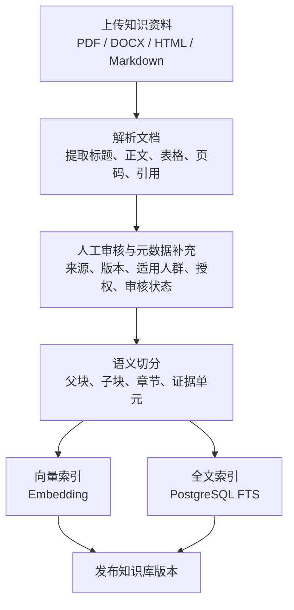
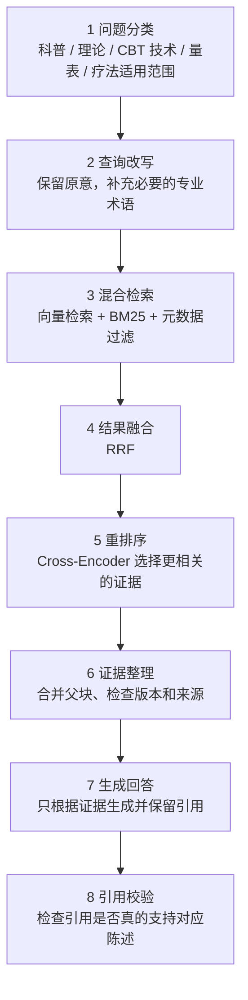

# 第 4 章 RAG 知识数据架构

第一版建议只维护**一套公共知识库**，但在数据模型中区分文档、知识块、来源、证据和版本。

## 4.1 知识库的数据流



> **注意：上传文档不等于知识已经可以被 Agent 使用。** 只有经过审核、解析和索引验证的文档才能进入可检索状态。

这条规则要落到代码里：`kb_document.status` 不达到 `published` 的文档，一律不进检索候选集，而不是"检索出来再过滤"。

## 4.2 数据库表设计

第一版建议建立以下核心表。

| 表名 | 作用 | 关键字段 |
|-|-|-|
| kb_collection | 知识库 | id、name、description |
| kb_document | 原始文档 | id、title、source、version、status |
| kb_document_version | 文档版本 | document_id、version、published_at |
| kb_chunk | 知识块 | id、document_version_id、content、embedding |
| kb_evidence | 证据单元 | chunk_id、evidence_type、population、recommendation |
| kb_citation | 引用定位 | chunk_id、page、section、url |
| kb_ingestion_job | 文档处理任务 | status、error、started_at |
| kb_review_record | 审核记录 | reviewer、decision、reason |

其中最重要的是 **kb_evidence**。它可以把普通文本转化成具有明确证据属性的知识单元：

```json
{
  "evidence_id": "ev_001",
  "chunk_id": "chunk_001",
  "evidence_type": "guideline_recommendation",
  "condition": "适用条件原文",
  "population": "指南规定的人群",
  "intervention": "指南提及的干预",
  "recommendation_strength": "原文记录",
  "evidence_quality": "原文记录",
  "limitations": [
    "指南明确指出的限制"
  ],
  "review_status": "approved"
}
```

这些字段是**数据结构**示例，不应让模型自行编造推荐强度或证据质量。无法确认的字段就保存为 `null` 或 `unknown`。

保留这张"重"表的理由见 [ADR-0006](../03-adr/ADR-0006-保留kb_evidence证据表.md)：它是与 Wysa "临床审核话术"对齐的最小代价方案——用结构化字段替代人力审核的规模。

## 4.3 kb_chunk 必须保留的字段

```
id
document_id
document_version_id
parent_chunk_id
chunk_index
title_path
content
embedding
page_start
page_end
section_path
language
created_at
```

**特别注意 `document_version_id`。** 如果指南更新了，不能直接覆盖旧文档的知识块；需要保留历史版本，并让查询默认使用当前已发布版本。这一条同时是"引用可追溯"和"证据可回滚"的前提。

## 4.4 知识块切分策略

心理学和医学知识不适合单纯按照 500 或 1000 个 Token 固定切分。建议采用三级结构：

| 层级 | 内容 | 用途 |
|-|-|-|
| 文档层 | 整份指南或教材 | 来源与上下文 |
| 父块 | 一个完整章节或主题 | 补充上下文 |
| 子块 | 一个完整知识点或证据单元 | 向量检索 |

示例：

```
《认知行为疗法指南》
  └── 第 3 章：治疗实施
       ├── 3.1 治疗适用范围
       ├── 3.2 治疗结构
       ├── 3.3 治疗技术
       └── 3.4 治疗效果评估
```

切分时必须遵守：

- 不能把推荐意见与其适用条件拆开；
- 不能把否定条件与肯定结论拆开；
- 表格必须保留标题和列名；
- 每个子块必须能追溯到原文页码或章节；
- 子块需要保留父块引用，检索后可以补充上下文。

前两条是硬约束：一条"对 X 人群不推荐 Y"被切成两半，检索出来就是一句错误的推荐。这类错误比召回率低严重得多。

## 4.5 检索流程

第一版的 RAG 查询流程共八步：



第一版可以先实现 **向量检索 + PostgreSQL 全文检索 + RRF**。Reranker 可以在检索质量测试后再加入（见 [第 11 章](11-评估指标.md)）。

## 4.6 用框架到什么程度

Spring AI 已经提供 `VectorStore`、`QuestionAnswerAdvisor` 和 `RetrievalAugmentationAdvisor` 等 RAG 组件，也支持 PostgreSQL/PGVector。可以先用它们实现基础检索，再把需要复杂控制的部分封装成自己的 `RagService`。

> **建议：不要把整个 RAG 写成一个 `QuestionAnswerAdvisor` 就结束。** 它适合简单问答，但这个系统还需要检索来源过滤、证据结构化、引用定位和输出验证。

分界线建议这样切：

| 用框架现成的 | 自己写 |
|-|-|
| `VectorStore` 的写入与相似度查询 | 检索候选集的白名单与版本过滤 |
| `RetrievalAugmentationAdvisor` 的简单拼装 | 证据结构化、父子块合并 |
| Advisor 的 prompt 模板注入 | 引用定位与引用校验（`verify_citations`） |

参考：
- [Spring AI RAG 文档](https://docs.spring.io/spring-ai/reference/api/retrieval-augmented-generation.html)

## 4.7 已落地：重排、生命周期、语料权限与在线评测

§4.5 里留了三个"以后再说"（重排、版本与来源检查、引用之外的治理），这一节把它们收掉。
四件事共同的主题是：**检索质量的上限由语料治理决定，不由模型决定。**

### 重排：先放大候选池，再截断

| 档 | 开关 | 行为 |
|-|-|-|
| `none` | `psych.ai.rerank.provider=none` | 显式声明"没装重排"。出问题先怀疑排序，而不是先怀疑重排 |
| `lexical`（默认） | 同上 = `lexical` | 不调模型：查询词覆盖率 0.7 + 相邻短语 0.3，再与召回分 6:4 混合 |
| `fixture` | 同上 = `fixture` | 读离线判好的分，按**内容键**（检索文本短 SHA）索引 |
| `http` | 同上 = `http` 并配 `psych.ai.rerank.url` | `/rerank` 协议，8 秒超时，失败退回召回顺序，不重试 |

三处容易写错的顺序：
1. 候选池必须放大（`pool-factor`，默认 3）。只取 topK 再重排，等于在截断后的名单里换座位；
2. 截断必须发生在重排**之后**；
3. 未判分的条目是 `-1` 而不是 `0`。当成 0 分会把它们排到所有低分命中之后，而"没判"只该保持原相对顺序。

实测（5 个查询，示例语料，样本小，只证明管道可用）：重排改变了 4/5 个查询的 top-1；
两位独立标注者 top-1 一致率 1.0、top-3 重合 0.87、逐条平均绝对差 0.045。

> **边界**：`rerank/agent-v1.json` 里的分是**子代理扮演 cross-encoder** 逐条判出来的，
> 不是 bge-reranker 的真实输出。真模型接上后换 `http` 档，这份文件退化为回归基准。
> 它的键是内容寻址的，重建语料后仍然对得上——用 chunk id 做键的标注文件，第二天就静默失效。

### 文档生命周期：内容哈希决定要不要重做

- `external_key` 唯一：同一篇资料只有一条记录，改标题不会变成新文档；
- `content_hash` 决定是否重切分与重向量化：没变就一个字节都不写；
- 内容变了 → 清旧块 → 写新版本 → 状态回到 `REVIEWING`。**审核签字是对那一版文本签的**，
  自动继承等于让一次未审的改动借用上一次的签字；
- `deleted_at` 软删除（检索立刻不可见，行保留），物理清理另给一条命令（默认保留 7 天）。

实现：`DocumentSyncService`、`IngestionService.ingestAs`；接口 `POST /api/knowledge/documents/sync`、
`DELETE /api/knowledge/documents/{id}`。

### 语料权限：在检索之前过滤

`kb_document.acl_scope` 存逗号分隔的范围（如 `team:cbt,role:clinician`），空表示公开。
`KnowledgeFlow` 接 `scopes`，先解析成"可见文档 id 集合"再进检索。

放在检索前而不是生成后，是因为两件事不一样：先取回来再删引用，越权内容已经进了模型上下文，
答案里可能已经泄露了它的意思。语义上也有区别——越权问题应当表现成"没有资料"，
而不是"有资料但不能说"，后者本身就泄露了存在性。

实现：`DocumentVisibility`（内存档与 PG 档共用同一份判定，避免两边慢慢分叉）、
`PUT /api/knowledge/documents/{id}/acl`。

### 在线评测：留痕、自动挑样本、按窗口看指标

- 每轮问答留痕：状态、证据是否充分、引用是否有效、命中数、延迟（`eval_query_log`）；
- 可疑样本自动进池：拒答、引用无效、管道异常（`eval_badcase`）。拒答不等于错误，
  但它永远值得看一眼——要么语料缺了，要么改写没覆盖这种问法，要么门槛太紧，三种修法完全不同；
- 摘要不合成总分：回答率、拒答率、引用有效率分开报，另给 P50/P95 与 top 拒答问题；
- 抽样是确定性的（固定步长），随机会让今天和昨天看的不是同一批。

实现：`OnlineEvalService`；接口 `/api/internal/eval/summary|badcases|sample`。
评测写入是旁路，失败只吞掉——不能让"存评测数据失败"把一次可用的回答变成 500。
