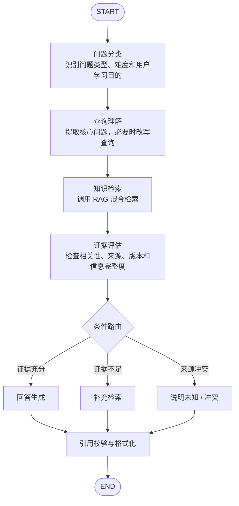
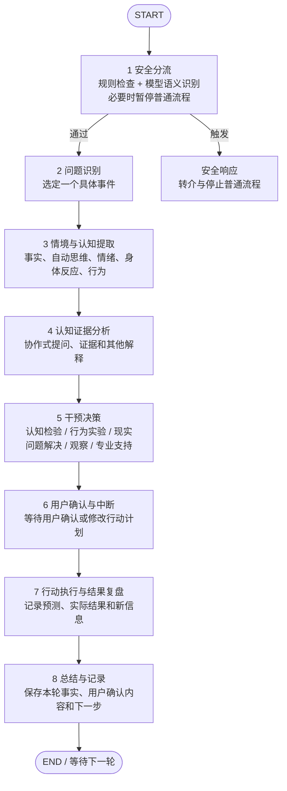

# 第 5 章 双 Graph 设计

> 原稿标题为"两个 LangGraph 的具体设计"。实现栈是 Spring AI Alibaba Graph（Java），不是 Python LangGraph，故本仓库统一称"双 Graph"。图结构与节点语义不受影响。

## 5.1 两个 CompiledGraph

建议建立两个独立的 `CompiledGraph`：

- **KnowledgeGraph** —— 知识问答、科普、学习。
- **CbtGraph** —— 结构化 CBT 自助练习。

它们**共享 `RagService`，但不共享业务 State**。

这样，一个知识问答会话不会污染 CBT 会话中的情绪、事件和行动状态。决策记录见 [ADR-0005](../03-adr/ADR-0005-双Graph独立State.md)。

## 5.2 KnowledgeGraph：心理知识学习工作流



节点清单：

| 节点 | 是否调用 LLM | 任务 |
|-|-|-|
| classify_query | 是 | 识别知识领域与问题类型 |
| rewrite_query | 是 | 查询改写 |
| retrieve_evidence | 否 | 调用 RAG 服务 |
| evaluate_evidence | 是 / 规则 | 判断证据是否足够 |
| generate_answer | 是 | 生成知识回答 |
| verify_citations | 规则 + 可选 LLM | 检查引用关联 |
| format_response | 否 | 组织最终结果 |

> **注意：检索本身尽量使用确定性 Java 服务，不必每个检索动作都调用 LLM。**

### 5.2.1 KnowledgeState

```java
public class KnowledgeState {

    String sessionId;

    String userQuestion;

    String queryType;

    String rewrittenQuery;

    List<String> queryTerms;

    List<EvidenceItem> retrievedEvidence;

    List<EvidenceItem> selectedEvidence;

    String evidenceStatus;

    String generatedAnswer;

    List<Citation> citations;

    List<String> unresolvedQuestions;
}
```

`EvidenceItem` 建议至少包含：

```java
public record EvidenceItem(
    String evidenceId,
    String documentId,
    String documentVersion,
    String title,
    String content,
    String sourceOrganization,
    String evidenceType,
    String page,
    String section,
    String sourceUrl
) {}
```

> **注意：`evidenceStatus` 应由明确规则与模型评估共同形成**，不能简单地让 LLM 输出一个 `high` 就认定证据可靠。规则侧至少要检查：是否有已发布版本、是否命中白名单来源、引用是否定位到页码、是否命中"冲突来源"名单。

## 5.3 CbtGraph：心理自助工作流

保留 8 个节点，但把**安全分流**和**用户交互机制**独立出来。



第 6 节点是**中断点**（interrupt），不是普通节点。它把 Graph 挂起、把控制权交回前端，等用户确认后再恢复。机制见 [第 6 章](06-交互与状态恢复.md)。

### 5.3.1 CBT 中哪些节点调用 RAG

不需要每个节点都检索。

| CBT 节点 | 是否调用 RAG | 检索内容 |
|-|-|-|
| 安全分流 | 不依赖普通心理知识 RAG | 另用经过审核的安全资源 |
| 问题识别 | 可选 | 通常不需要 |
| 情境与认知提取 | 可选 | CBT 基础概念 |
| 认知证据分析 | 可选 | 自动思维、苏格拉底式提问 |
| 干预决策 | 建议调用 | 不同干预的适用范围和限制 |
| 行动设计 | 建议调用 | 相应自助练习指导 |
| 结果复盘 | 可选 | 复盘方法 |
| 总结记录 | 不需要 | 结构化整理 |

一个关键设计：

> **RAG 提供的是干预知识依据，不是替用户决定干预方式。**

例如，模型可以检索到行为实验的理论和操作原则，但行动是否适合当前用户，仍需要结合用户表达、边界规则和自主确认。

### 5.3.2 CbtState

```java
public class CbtState {

    String sessionId;

    String currentStage;

    String safetyStatus;

    String targetProblem;

    SituationData situation;

    ThoughtData automaticThought;

    List<EmotionData> emotions;

    List<String> evidenceFor;

    List<String> evidenceAgainst;

    String balancedThoughtCandidate;

    String userConfirmedThought;

    String interventionType;

    ActionPlan actionPlan;

    ActionResult actionResult;

    String pendingQuestion;

    boolean awaitingUser;

    String sessionSummary;
}
```

> **建议把 `userConfirmedThought` 与 `balancedThoughtCandidate` 分开**，不要用一个字段混存"模型建议"和"用户认可的内容"。

这不是命名洁癖。用户说"我想改一下刚才那个想法"时，前者是待审批的候选，后者是已生效的结论；混存会导致两种语义互相覆盖，且审计时无法回答"最终生效的是谁说的"。详见 [§2.3](02-相关方案横向对比.md) 关于平台层"会话=消息历史"的对比。

## 5.4 两个 Graph 的共享与隔离

| 项 | KnowledgeGraph | CbtGraph | 是否共享 |
|-|-|-|-|
| RagService | 用 | 用 | **共享**（按接口调用） |
| State 类型 | KnowledgeState | CbtState | 不共享 |
| threadId | 每会话一个 | 每会话一个 | 不共享，命名空间隔离 |
| 提示词 | prompts/knowledge/* | prompts/cbt/* | 分开存放 |
| 安全规则 | 普通边界提示 | 硬编码转介路径 | 规则来源不同 |
