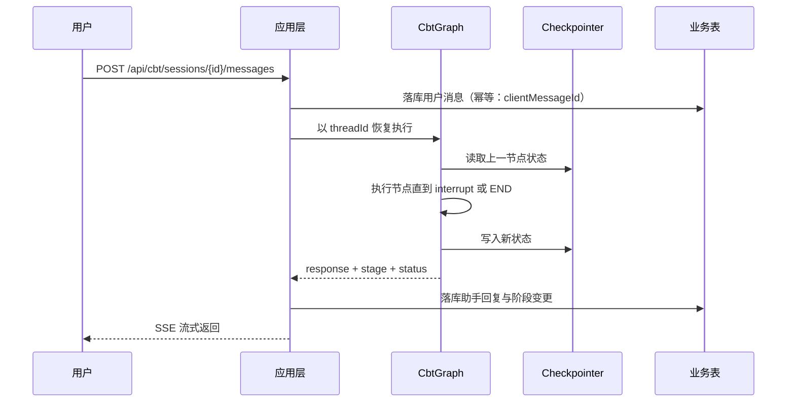

# 第 6 章 交互与 Graph 状态恢复

## 6.1 为什么普通问答的交互方式不成立

这个项目不能像普通问答一样，每次用户发消息就重新从 START 跑一遍。

以 CBT 为例：

1. Agent 询问："最近一次让你产生这种感受的具体事情是什么？"
2. 用户回答。
3. Graph 从保存的状态恢复。
4. Agent 进入下一个节点。
5. Agent 再问一个问题。
6. 再次暂停。

这就需要 **Checkpoint**。Spring AI Alibaba Graph 的持久化机制使用 `threadId` 标识一个工作流会话，可以保存节点状态、恢复执行并查看状态历史。

参考：
- [Graph 持久化文档](https://www.java2ai.com/docs/frameworks/graph-core/core/persistence/)
- [Spring AI Alibaba Graph README](https://github.com/alibaba/spring-ai-alibaba/blob/main/spring-ai-alibaba-graph-core/README.md)

## 6.2 三种 ID 各管一件事

| ID | 用途 |
|-|-|
| userId | 用户身份 |
| sessionId | 业务会话 ID |
| threadId | Graph 执行状态 ID |

一般一个 CBT 会话对应一个稳定的 `threadId`。

不要把三者合成一个。合成之后会出现两类事故：同一用户开两个会话导致状态串台；或者"重新开始一次练习"必须换 threadId 时，历史记录跟着断掉。

## 6.3 Checkpoint 不等于业务数据库

- **Checkpoint** 保存流程恢复所需状态；
- **业务表**保存用户消息、确认记录、行动结果和可追溯历史；
- **不要把全部患者或用户隐私信息无差别地复制进 Checkpoint。**

两者对不齐时的处理原则：以业务表为准，Checkpoint 只作为"流程能继续走"的运行时快照，允许重建。

需要特别检查所选版本的 Checkpointer 实现及其数据库支持情况：**不要默认 MySQL 或 PostgreSQL 一定有现成的官方 Saver**。开发阶段可用 `MemorySaver`，正式环境再选择兼容的持久化方案。官方持久化文档也明确展示了 `MemorySaver` 示例。

这也是 [docs/README.md](../README.md) 里列出的待办之一：版本锁定后必须逐项核实存储后端支持。

## 6.4 一轮对话的时序

`clientMessageId` 的作用是幂等：前端重试不应产生两条用户消息，也不应把 Graph 推进两步。

## 6.5 中断点的约束

1. 一个 Graph 里中断点越少越好，CBT 第一版只保留"用户确认行动计划"一处。
2. 中断时必须把"用户需要看到的东西"一次性给全（问题、候选想法、计划草案），避免恢复后又追加问题，导致用户以为系统卡住。
3. 恢复只允许由用户消息触发，**不允许前端直接 PUT 任意 State 字段**。这是 [第 8 章](08-接口设计.md) 的接口约束。
