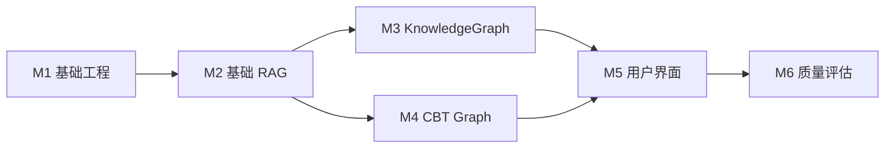

# 第 10 章 里程碑与开发顺序

## 10.1 原则：不要并行开两个 Graph

不要同时开发两个 Graph 和整套知识管理平台。顺序上有一条依赖链：**没有可检索的审核知识，Graph 的检索节点就是空转；没有 Graph，前端没有可展示的状态。**

M3 与 M4 可并行（都只依赖 M2），其余串行。

## 10.2 六个里程碑

### M1：基础工程

Spring Boot、Spring AI、Spring AI Alibaba Graph、PostgreSQL、pgvector。

先完成：能调用模型、创建 Graph、保存和读取状态。

**验收：** 能调用模型、创建 Graph、保存和读取状态。

### M2：基础 RAG

文档上传、解析、切分、Embedding、混合检索、引用定位。

**验收：** 能针对一组审核过的 CBT 资料回答问题，并定位到来源。

### M3：KnowledgeGraph

实现问题分类、查询改写、检索、证据评估、回答生成、引用校验。

**验收：** 证据不足时能够拒绝编造，引用能支持具体回答。

### M4：CBT Graph

实现安全分流、事件识别、认知提取、认知检验和干预决策。

**验收：** 能够跨多轮对话暂停、恢复，并保留用户确认状态。

> M4 的前置阻塞项：安全分流规则必须先成文（[docs/02-设计/安全分流规则.md](../02-设计/安全分流规则.md)），代码只是它的实现。

### M5：用户界面

知识学习页面、CBT 对话页面、记录查看页面。

**验收：** 用户可以独立使用两个工作流。

> 当前进度（2026-11-18）：**房间**（[世界观设计](../02-设计/世界观与导航.md) §10 的默认界面）已接真实接口并落库，
> 知识页与记录页未开始，Vue 工程未开始。拆解见世界观 §9（M5-α/β 已实装，γ/δ 未做），
> 逐版验收证据见 [版本记录](../05-评估/版本记录.md)；v0.1.0 的原始走查在 [归档](../99-归档/v0.1.0-全链路验收.md)。

### M6：质量评估

检索测试、提示词测试、状态恢复测试、安全测试。

**验收：** 建立可重复运行的测试集，记录每次版本变更的结果。

> 当前进度（v0.5.0）：知识 34 条、安全 25 条、CBT 流程 8 条的正式集与三个跑分脚本已建；
> 真实模型（本地 Ollama）与三组对照小样本已跑，结果见 [版本记录](../05-评估/版本记录.md)。
> 仍缺大样本、临床标注与三组对照的完整规模。

## 10.3 每个里程碑的"完成"定义

一个里程碑只有同时满足以下三条才算完成，否则只是"代码写了"：

1. 有可执行的验收脚本或手工验收清单；
2. 结果留档（excel / markdown / eval 输出），不是口头"试过了"；
3. 涉及架构结论变化时，ADR 已更新。

## 10.4 下一步建议

把 **M1 + M2** 转化为可直接交给编码 Agent 的 BDD 开发规范，先完成 Java 工程、知识文档入库和 RAG 检索闭环，再接入两个 Graph。
