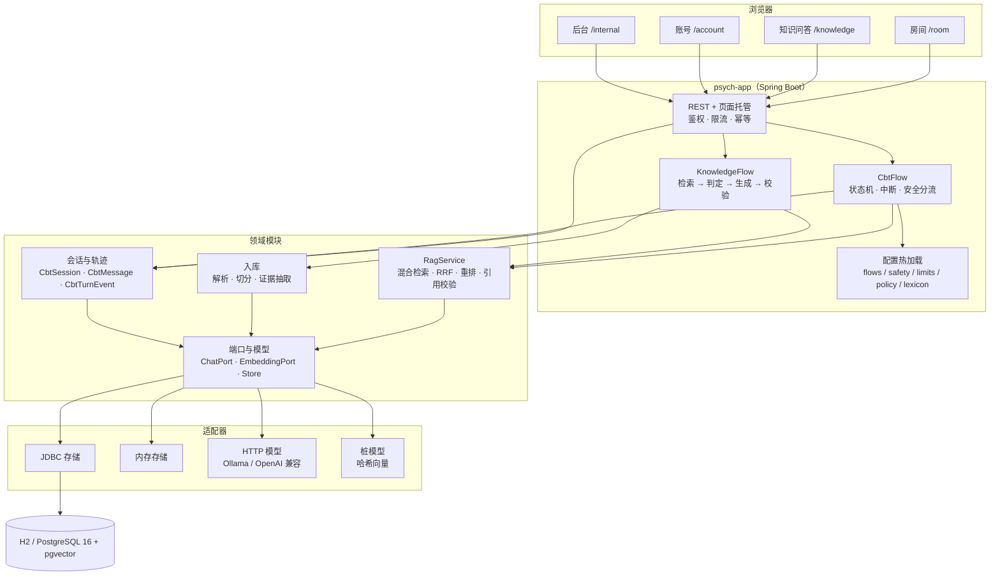
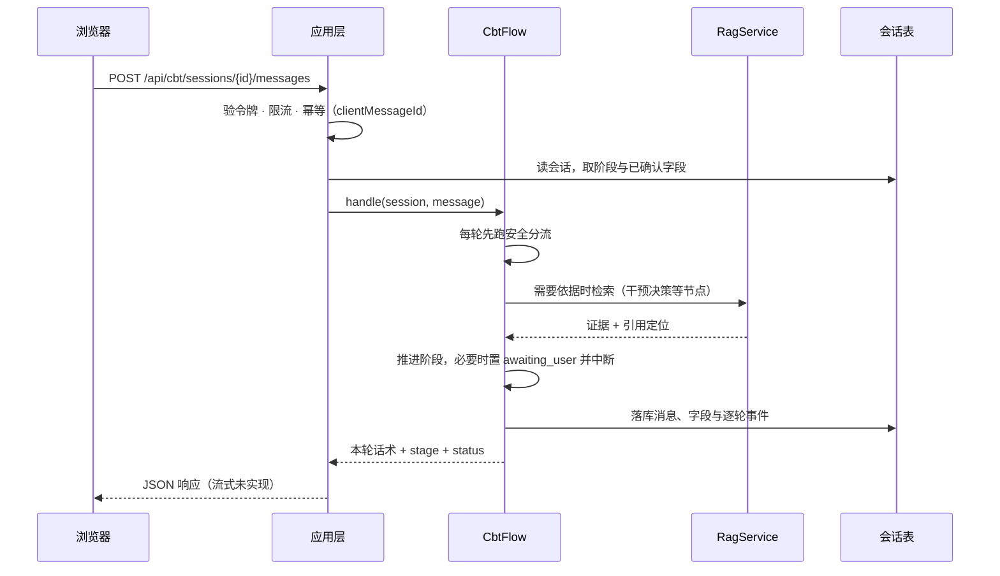

# 总体架构

## 1. 形态

**Java 21 模块化单体，一个进程，一套数据库。**

这不是技术偏好的结果，而是三条约束的交点：需要确定性状态机（排除纯提示词方案）、
需要证据可溯源（排除只靠模型记忆）、需要可私有化部署（排除 SaaS 依赖）。
取舍过程见 [方案对比](03-方案对比.md)，选型记录见 [ADR-0002](../04-adr/ADR-0002-Java栈与Graph选型.md)。

单体的具体含义：

- 没有 Redis、没有消息队列：限流走数据库表的原子 upsert，流程是同步状态机，不存在跨进程解耦点；
- 静态页面打在 jar 里由应用自己托管，不需要单独的前端服务；
- 反向代理（Caddy）是可选叠层，只负责 TLS、压缩与安全头。

## 2. 组件

## 3. 各层职责

| 层 | 只负责 | 不负责 | 越界的后果 |
|-|-|-|-|
| 页面 | 呈现、输入、交互 | 决定流程走向、拼装状态 | 前端一改就能跳步骤，状态机失去意义 |
| 应用层 | 身份、会话、接口、权限、审计 | 心理学结论、检索策略 | 业务规则散在 Controller 里，无法回归 |
| 流程 | 节点编排、条件路由、中断恢复 | 管理数据库事务、直接造证据 | 流程与存储耦合，换库要改流程 |
| 检索 | 召回、过滤、证据组装、引用定位 | 决定 CBT 走到哪一步 | RAG 变成"第二个决策者" |
| 存储 | 状态与事实的持久化 | 业务判断 | 状态语义漂移，查不清"谁确认了什么" |

## 4. 三条架构原则

> **流程由代码推进，证据来自知识库，状态存在数据库，模型只负责理解与改写。**

由此推出三条禁令：

1. **不让模型决定业务状态。** 走到第几步、用户确认了什么，必须是显式字段，不是"模型记得"。
2. **不让检索结果直接成为结论。** 检索到的是"干预知识依据"，不是"这个用户应该怎么做"。
3. **不让检索动作都走模型。** 检索、融合、引用定位是确定性代码；模型只用于理解与生成。

## 5. 一次请求的流动

关键点：**只有"发消息"和"确认"两个入口能推进流程**；前端不能写任何状态字段。
接口细节见 [接口契约](../02-架构/05-接口契约.md)。

## 6. 运行形态

| 形态 | 存储 | 模型 | 用途 |
|-|-|-|-|
| 默认（无 profile） | 内存 | 桩 | 只验证流程，重启即清空 |
| `h2` | H2 文件库 | 本机 Ollama | 单机验收、验证重启存活 |
| `h2,stub` | H2 文件库 | 桩 | 完全离线 |
| `pg` | PostgreSQL + pgvector | 可配 | 生产形态 |
| 容器 | PostgreSQL + pgvector | 桩，`--ai` 起 Ollama | 一键演示与部署 |

知识库在 H2 档仍是内存实现（H2 没有 pgvector），所以 H2 档只能验证会话域；
pgvector 路径在容器档实跑过。详细部署与排障见 [deploy/README](../../deploy/README.md)。
