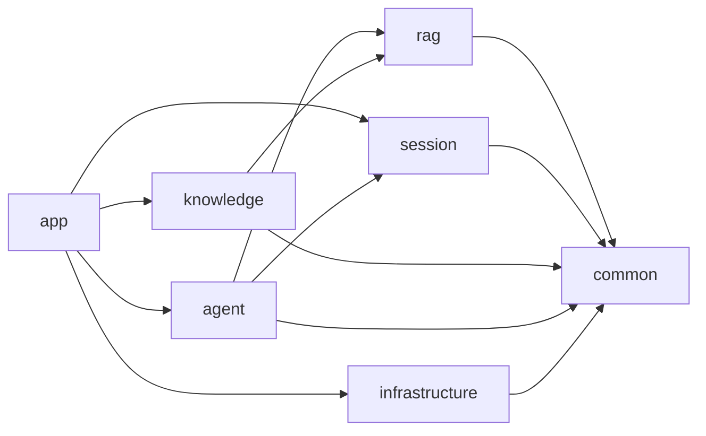

# 模块与技术栈

## 1. 为什么是模块化单体

| 维度 | 单体 | 微服务 |
|-|-|-|
| 部署与调试 | 一个进程，一次启动 | 需要编排、服务发现、链路追踪 |
| 事务 | 本地事务即可保证会话与消息一致 | 跨服务最终一致，复杂度陡增 |
| 拆分成本 | 边界清楚时可按包外迁 | 边界没想清楚就拆，等于把错误固化 |
| 当前负载 | 单机足够（128 并发压测 0 错误） | 无收益 |

结论：先按模块划清边界，等负载或团队规模真的需要时再拆。记录见
[ADR-0001](../04-adr/ADR-0001-模块化单体而非微服务.md)。

## 2. 模块

```
backend/
├── psych-common          领域模型 + 端口 + 输出闸门接口
├── psych-session         会话、消息、逐轮轨迹
├── psych-knowledge       Markdown 解析、父子块切分、证据抽取
├── psych-rag             混合检索、RRF、重排、引用校验、提示词
├── psych-agent           CbtFlow、安全分流、流程/规则/参数配置
├── psych-infrastructure  存储适配（内存 / JDBC）、模型适配（桩 / HTTP）、输出闸门实现
└── psych-app             启动入口、REST、页面、种子数据、账号与审核
```

| 模块 | 主要职责 | 不应该负责 |
|-|-|-|
| `common` | 领域对象、`ChatPort` / `EmbeddingPort` / `CbtSessionStore` 等端口 | 依赖任何上层模块 |
| `session` | 会话语义：阶段、字段、确认、轨迹事件 | 决定心理学结论、调用模型 |
| `knowledge` | 解析、切分、证据抽取、入库编排 | 直接生成答案 |
| `rag` | 召回、融合、重排、证据组装、引用定位 | 决定 CBT 流程 |
| `agent` | 节点编排、条件路由、安全分流、配置校验 | 自己管数据库事务 |
| `infrastructure` | 把端口落到 JDBC / 内存 / HTTP 模型 | 写业务判断 |
| `app` | HTTP、鉴权、限流、页面、装配 | 藏流程逻辑 |

依赖只允许向下：



两条硬约束：

1. **`rag` 不依赖 `agent`**：`rag` 的公开签名里不得出现 `CbtState` / `KnowledgeState`，
   只认查询对象与证据列表。这样换成 Python 侧实现或新增一个工作流时，检索层不用重写
   （[ADR-0005](../04-adr/ADR-0005-双Graph独立State.md)）。
2. **`app` 不写流程**：Controller 只做校验、鉴权、装配与落库，流程推进全部在 `agent`。

## 3. 包结构

```
com.socraticmind
├── common
│   ├── account        账号与令牌载荷
│   ├── guard          输出闸门（长度 / 禁句 / 重合度）与策略档位
│   ├── model          跨模块的领域对象
│   ├── port           ChatPort · EmbeddingPort · Store 接口
│   └── support        Ids、时钟等小工具
├── session            CbtSession · CbtMessage · CbtTurnEvent · CbtStage
├── knowledge
│   ├── parse          Markdown → 结构化文档
│   ├── chunk          父子块切分
│   ├── metadata       标题路径、页码、来源
│   ├── service        入库编排
│   └── dto
├── rag
│   ├── query          查询理解与改写
│   ├── retrieval      向量 + 全文召回、RRF、重排
│   ├── evidence       证据组装与父块合并
│   ├── validation     引用校验
│   └── service
├── agent
│   ├── cbt            CbtFlow · SafetyScreener · DistortionTagger · EmotionTagger
│   ├── cbt/flow       FlowDefinition · FlowValidator · FlowParamsStore
│   ├── cbt/safety     规则、用例、存储、校验
│   ├── knowledge      KnowledgeFlow · OnlineEvalService
│   └── config         版本历史、运行参数
├── infrastructure
│   ├── ai             桩模型、OpenAI 兼容 HTTP 适配
│   ├── guard          GuardedChatPort 与审计
│   └── store          内存 / JDBC 实现
└── app
    ├── auth           注册、登录、恢复码、令牌
    ├── security       匿名令牌、内部令牌、操作者会话
    ├── review         文档审核与规则审核记录
    ├── lexicon        敏感词库
    ├── share          一次性分享链接
    ├── asr            本地语音转写
    ├── seed           示例语料与账号种子
    └── web            REST 与页面控制器
```

Maven 坐标带 `psych-` 前缀，Java 包名不带。

## 4. 技术栈

| 组件 | 版本 / 取值 | 说明 |
|-|-|-|
| JDK | 21（Temurin 21.0.12） | `maven.compiler.release=21` |
| Spring Boot | 3.5.6 | 父 POM；Web、Validation、Actuator |
| 数据库 | H2 文件库 / PostgreSQL 16 + pgvector | 同一份 DDL（PostgreSQL 兼容模式） |
| 连接池 | HikariCP | 默认 20；与 Tomcat 线程数（100）一起调 |
| JSON | Jackson | 配置、轨迹、接口 |
| 前端 | 原生 HTML/CSS/JS | 由应用托管，无构建步骤 |
| 模型 | 桩 / Ollama / OpenAI 兼容 | 通过 `ChatPort` 与 `EmbeddingPort` 接入 |
| 语音转写 | Windows System.Speech（可选） | 进程钩子调用，不落库 |

**关于 Spring AI Alibaba Graph**：目标选型是它，当前实现是手写状态机，未引入任何 Spring AI 依赖。
原因与回补条件写在 [ADR-0002](../04-adr/ADR-0002-Java栈与Graph选型.md) 的备注里——
简单说，M1–M2 要证明的是"证据能不能用、引用对不对得上"，与用哪个 SDK 无关；
端口隔离让将来接入只是新增一个适配器，不动业务代码。

## 5. 常用命令

```bash
cd backend
mvn -o test                      # 单元 + 集成测试
mvn -o package -DskipTests       # 产出 psych-app/target/psych-app-<version>.jar
```

测试分两层：模块内单测（流程、安全、配置、检索）+ `psych-app` 的接口与装配测试。
所有测试都不依赖外部模型与数据库。

## 6. 加东西时的位置

| 要加 | 放哪 | 不要 |
|-|-|-|
| 新存储后端 | `infrastructure/store`，实现 `common/port` 的接口 | 在业务模块里写 SQL |
| 新模型供应商 | `infrastructure/ai`，实现 `ChatPort` | 在 `agent` 里拼 HTTP |
| 新流程节点 | `agent/cbt` + `config/flows` 定义 | 在 Controller 里写 if/else |
| 新检索信号 | `rag/retrieval` | 在 `agent` 里做检索 |
| 新页面 | `app/src/main/resources/static` | 引入前端构建链 |
