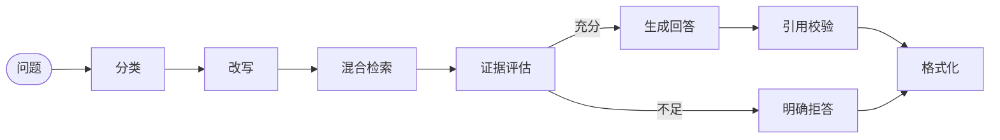
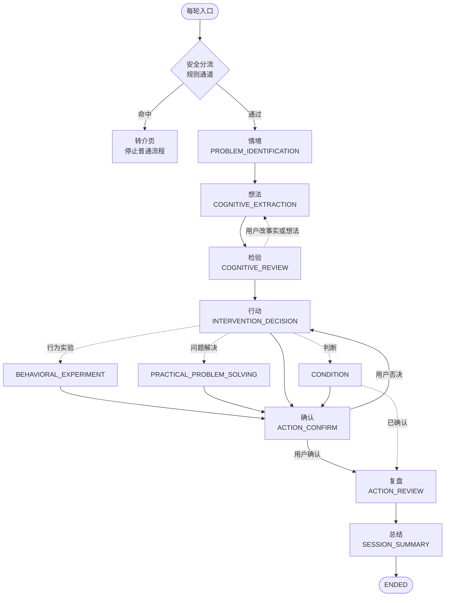
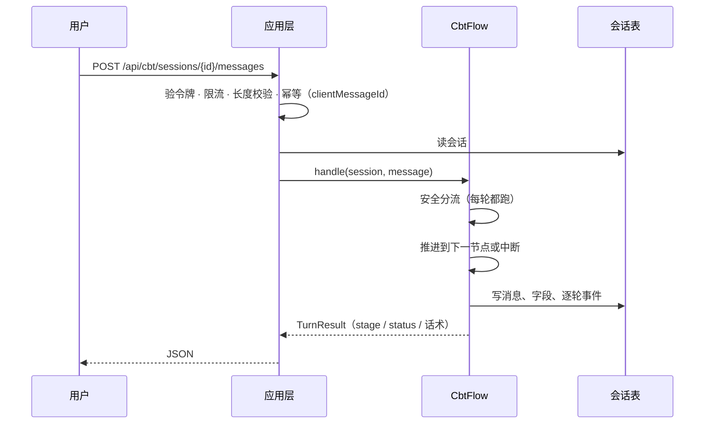

# 流程与状态

## 1. 为什么不是"消息历史"

普通问答每轮从 START 跑一遍就够了；CBT 不行：

1. 系统问"最近一次让你产生这种感受的具体事情是什么？"；
2. 用户回答；
3. 流程从中断处恢复，进入下一个节点；
4. 再问一个问题，再暂停。

这里需要的是**可暂停、可确认、可回滚的业务状态机**。把它建模成消息历史会丢三件事：
用户确认过哪一句、当前走到第几步、这句结论该不该说。

两条由此推出的规则：

- 业务状态存在会话表里（`cbt_session`），不是只存在模型上下文或运行时快照里；
- 只有"发消息"与"确认"两个入口能推进流程，前端不能写任何状态字段。

## 2. 两个流程

两个流程**共享 `RagService`，不共享业务状态**（[ADR-0005](../04-adr/ADR-0005-双Graph独立State.md)）。
一个知识问答会话不会污染 CBT 会话里的情绪、事件与行动状态。

### 2.1 KnowledgeFlow：一条直线，七个节点

| 节点 | 调模型 | 说明 |
|-|-|-|
| 分类 | 否（规则） | 科普 / 理论 / CBT 技术 / 量表 / 疗法适用范围 |
| 改写 | 否（规则） | 保留原意，补专业术语 |
| 检索 | 否 | 向量 + 全文 + 元数据过滤，RRF 融合 |
| 证据评估 | 否 | 分数门槛、版本、来源、冲突检查 |
| 生成 | **是** | 只根据证据生成，逐条挂引用 |
| 引用校验 | 否 | 检查"引用是否支持该陈述"，不是"是否相关" |
| 格式化 | 否 | 组织脚注与出处 |

证据不足是正常业务结果（`EVIDENCE_INSUFFICIENT`），不是异常。
模型在正文里说"资料不足"时，状态也会被改判为拒答——不靠提示词自觉。

### 2.2 CbtFlow：八段主干，可配置分支

**对外只有五颗石子**（`visibleIndex` 0–4）：情境 / 想法 / 检验 / 行动 / 复盘。
内部节点更细，因为"确认"与"行动"是两件事，混在一段里无法表达中断。
安全暂停与结束不显示进度（`-1`）。

| 阶段 | 进入条件 | 退出条件 | 中断 |
|-|-|-|-|
| `PROBLEM_IDENTIFICATION` | 安全通过 | 用户选定一个具体事件 | 否 |
| `COGNITIVE_EXTRACTION` | 有具体事件 | 事实、自动思维、情绪、行为齐备（可缺项标记） | 否 |
| `COGNITIVE_REVIEW` | 有自动思维 | 产出候选想法 + 正反证据 | 否 |
| `INTERVENTION_DECISION` | 有候选想法 | 选定干预类型与计划草案 | 否 |
| `BEHAVIORAL_EXPERIMENT` / `PRACTICAL_PROBLEM_SOLVING` | 干预类型命中 | 产出执行细节 | 否 |
| `CONDITION` | 分支需要判断 | 立即求值并继续，不等输入 | 否 |
| `ACTION_CONFIRM` | 有计划草案 | **用户明确确认** | **是** |
| `ACTION_REVIEW` | 行动已执行或用户报告 | 记录结果与新信息 | 否 |
| `SESSION_SUMMARY` | 复盘完成 | 生成 summary | 否 |
| `ENDED` / `SAFETY_HOLD` | 结束或转介 | — | 终态 |
| `FREE` | 走到门外 | — | 不在流程内：无阶段推进、无待确认 |

## 3. 状态的写法

CbtState 的字段被落到 `cbt_session` 的一行里（[数据模型](04-数据模型.md)），关键是把
"模型建议"与"用户认可"分开：

| 字段 | 谁写 | 语义 |
|-|-|-|
| `candidateThought` | 检验节点 | 模型改写出的候选说法，待审批 |
| `userConfirmedThought` | **只有确认接口** | 用户按过确认键之后生效的结论 |
| `actionPlan` | 行动节点 | 计划草案 |
| `actionResult` | 复盘节点 | 后来实际发生了什么 |
| `safetyStatus` | 安全分流 | `hold` / `review` / 空 |
| `awaitingUser` | 确认节点 | 是否停在中断点 |

用一个字段混存"模型建议"和"用户认可"会导致两种语义互相覆盖，审计时也答不出"最终生效的是谁说的"。
用户说"我想改一下刚才那个想法"时，改的是候选字段，不是重跑整段对话。

## 4. 中断点

第一版只保留一处中断：**确认行动计划**。

1. 中断时必须把用户需要看到的东西一次性给全（改写后的说法、计划、下一步），
   避免恢复后又追加问题，让用户以为系统卡住；
2. 恢复只允许由用户消息或确认触发，不允许前端 PUT 任意字段；
3. 用户否决计划时回到 `INTERVENTION_DECISION`，不回到更早的阶段；
   改事实或改自动思维时才允许回退到 `COGNITIVE_EXTRACTION`，并清空候选想法。

## 5. 三种 ID 与两层持久化

| ID | 用途 |
|-|-|
| `userId` | 身份（设备令牌或账号令牌还原），不由前端声明 |
| `sessionId` | 业务会话 ID，带随机后缀，不可枚举 |
| `threadId` | 运行时执行标识，一个会话一个稳定值 |

不要把三者合成一个：合成后同一用户开两个会话会串台，"重新开始一轮"时历史也会跟着断。

| 层 | 存什么 | 丢了怎么办 |
|-|-|-|
| 会话表（`cbt_session` / `cbt_message` / `cbt_turn`） | 用户可见事实、确认记录、逐轮决策依据 | 不可丢 |
| 运行时快照（Checkpoint） | 流程能继续跑所需的状态 | 允许重建 |

当前实现没有引入框架 Checkpoint：状态直接在 `CbtSession` 里，进程内可恢复，落库后重启可恢复。
将来接框架时，`CbtSession` 作为业务表继续保留，Checkpoint 只作运行时快照。

## 6. 一轮的时序

`clientMessageId` 用于幂等：前端重试不应产生两条用户消息，也不应把流程推进两步。

## 7. 流程是可配置的

节点话术、去向、是否调模型、干预关键词都在 `backend/config/flows/<库名>/{draft,published}.json` 里，
代码只保留"这一步写哪个字段"。发布前由 `FlowValidator` 做四类校验：

| 类 | 规则 | 失败例子 |
|-|-|-|
| 结构 | 八节点齐全、去向在白名单、能从情境走到总结 | 把"检验"连到"总结"；判断节点缺兜底 |
| 语义 | 模型档位只能绑在对应阶段 | 给"情境"绑 `cbt_balance` |
| 文案 | 非空、≤1200 字、占位符必须认识 | `{{thougt}}` 拼错会原样漏给用户 |
| 枚举 | 干预类型键齐全、关键词 ≤20 个且 ≤12 字 | 删掉 `self_monitoring` |

**能改**：话术、节点位置、下一步、分支、判断条件、是否调模型。
**不能改**：八个主干节点不能删、字段语义由代码定、安全分流不在画布上（每轮硬跑）、
分支目标必须在白名单里。原因与操作细节见 [内部后台 §流程画布](../03-设计/03-内部后台.md)。

## 8. 共享与隔离

| 项 | KnowledgeFlow | CbtFlow | 是否共享 |
|-|-|-|-|
| `RagService` | 用 | 用 | **共享**（按接口调用） |
| State | 无状态，单次请求 | `CbtSession` | 不共享 |
| 会话表 | 不留历史 | `cbt_session` | 分开 |
| 提示词 | `prompts/knowledge/*` | `prompts/cbt/*` | 分开存放 |
| 安全规则 | 普通边界提示 | 每轮硬跑的分流 | 规则来源不同 |

CBT 中哪些节点调 RAG：**行动**建议调用（干预适用范围与限制），**检验**可选（自动思维、苏格拉底式提问），
其余节点不需要。检索给的是"干预知识依据"，不是替用户决定干预方式。
