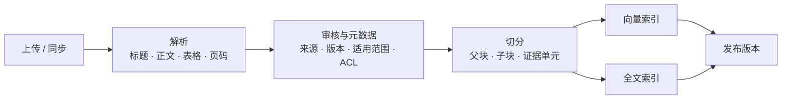

# RAG 与知识库

只维护一套公共知识库，但在数据模型里区分文档、版本、知识块、来源、证据与审核记录。
表结构见 [数据模型](04-数据模型.md)，本文说流程与口径。

## 1. 入库流水线



**上传不等于可被检索。** 只有 `status=published` 的文档进入候选集——在检索前过滤，
不是"检索出来再删"。这条要落在代码里，不能靠提示词。

## 2. 证据单元：`kb_evidence`

普通 chunk 只能回答"这段话出自哪里"，回答不了"这条推荐适用于谁、强度多高、有什么限制"。
`kb_evidence` 把这些拆成结构化字段：

```json
{
  "chunk_id": "chunk_001",
  "evidence_type": "guideline_recommendation",
  "condition": "适用条件原文",
  "population": "指南规定的人群",
  "intervention": "指南提及的干预",
  "recommendation_strength": "原文记录",
  "evidence_quality": "原文记录",
  "limitations": ["指南明确指出的限制"],
  "review_status": "approved"
}
```

这些字段**只从原文抽取，不允许模型编造**：无法确认就存 `null` 或 `unknown`。
保留这张"重"表的理由见 [ADR-0006](../04-adr/ADR-0006-保留kb_evidence证据表.md)。

## 3. 切分：三段结构

心理学与医学文本不适合按固定 500/1000 token 切。

| 层级 | 内容 | 用途 |
|-|-|-|
| 文档 | 整份指南或教材 | 来源与上下文 |
| 父块 | 一个完整章节或主题 | 检索后补上下文 |
| 子块 | 一个完整知识点或证据单元 | 向量检索的最小单位 |

硬约束：

- 不把推荐意见与其适用条件拆开；
- 不把否定条件与肯定结论拆开；
- 表格保留标题与列名；
- 每个子块能追溯到页码或章节；
- 子块保留 `parent_chunk_id`，检索后可回填上下文。

前两条比召回率重要：一条"对 X 人群不推荐 Y"被切成两半，检索出来就是一句错误的推荐。

`kb_chunk` 必须保留 `document_version_id`：指南更新时不能覆盖旧块，
查询默认用当前已发布版本，历史版本用于追溯与回滚。

## 4. 检索：八步


前四步与第六、八步都是确定性代码，只有生成调模型。

### 重排：先放大候选池，再截断

| 档 | 开关 | 行为 |
|-|-|-|
| `none` | `psych.ai.rerank.provider=none` | 显式声明"没装重排" |
| `lexical`（默认） | 同上 = `lexical` | 不调模型：查询词覆盖率 0.7 + 相邻短语 0.3，与召回分 6:4 混合 |
| `fixture` | 同上 = `fixture` | 读离线判好的分，按内容键（检索文本短 SHA）索引 |
| `http` | 同上 = `http` 并配 `rerank.url` | `/rerank` 协议，8 秒超时，失败退回召回顺序，不重试 |

三处容易写错的顺序：

1. 候选池必须先放大（`pool-factor` 默认 3）：只取 topK 再重排，等于在截断后的名单里换座位；
2. 截断必须发生在重排**之后**；
3. 未判分的条目是 `-1` 而不是 `0`：当成 0 分会把它们排到所有低分命中之后，
   而"没判"只该保持原相对顺序。

实测（5 个查询，示例语料）：重排改变了 4/5 个查询的 top-1；两位独立标注者 top-1 一致率 1.0、
top-3 重合 0.87、逐条平均绝对差 0.045。**样本小，只证明管道可用。**

> 边界：`rerank/agent-v1.json` 里的分是子代理扮演 cross-encoder 判出来的，不是 bge-reranker 的真实输出。
> 接真模型后换 `http` 档，这份文件退化为回归基准。用内容键而不是 chunk id，重建语料后仍然对得上。

## 5. 语料治理

| 机制 | 做法 | 为什么 |
|-|-|-|
| 去重 | `external_key` 唯一 | 改标题不会变成新文档 |
| 增量 | `content_hash` 决定是否重切分、重向量化 | 没变就一个字节都不写 |
| 改版 | 清旧块 → 写新版本 → 回 `REVIEWING` | 审核签字是对那一版文本签的，自动继承等于借用上一次签字 |
| 删除 | `deleted_at` 软删除，检索立刻不可见，7 天后物理清理 | 误删可恢复，检索不留脏数据 |

## 6. 权限：在检索之前过滤

`kb_document.acl_scope` 存逗号分隔的范围（如 `team:cbt,role:clinician`），空表示公开。
检索前先解析成"可见文档 id 集合"，再进候选集。

放在检索前而不是生成后，因为两件事不一样：

- 先取回来再删引用，越权内容已经进了模型上下文，答案里可能已经泄露了它的意思；
- 语义上也该是"没有资料"，而不是"有资料但不能说"——后者本身泄露了存在性。

内存档与 PG 档共用同一份判定（`DocumentVisibility`），避免两边慢慢分叉。

## 7. 在线评测

- 每轮问答留痕：状态、证据是否充分、引用是否有效、命中数、延迟（`eval_query_log`）；
- 可疑样本自动进池：拒答、引用无效、管道异常（`eval_badcase`）。
  拒答不等于错误，但它永远值得看一眼——要么语料缺了，要么改写没覆盖这种问法，要么门槛太紧；
- 指标不合成总分：回答率、拒答率、引用有效率分开报，另给 P50/P95 与 top 拒答问题；
- 抽样是确定性的（固定步长），随机会让今天和昨天看的不是同一批。

评测写入是旁路，失败只吞掉——不能让"存评测数据失败"把一次可用回答变成 500。

## 8. 用到框架的哪一层

Spring AI 提供 `VectorStore`、`RetrievalAugmentationAdvisor` 等组件，可以承担写入与相似度查询。
但**不要把一个 `QuestionAnswerAdvisor` 当成整个 RAG**：还需要来源过滤、证据结构化、引用定位与输出校验。

| 适合现成组件 | 必须自己写 |
|-|-|
| 向量写入与相似度查询 | 候选集的白名单、版本与 ACL 过滤 |
| 简单的上下文拼装 | 父子块合并、证据结构化 |
| 提示词模板注入 | 引用定位与引用校验 |
