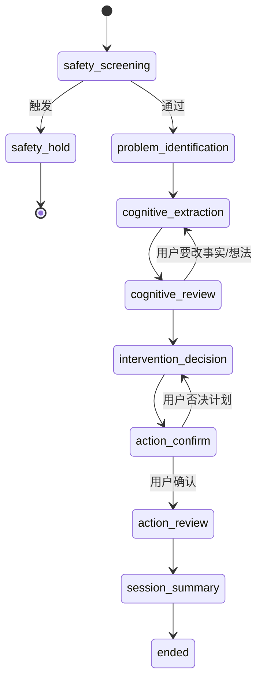

# CBT 状态机

> 上位文档：[§5.3 CbtGraph](../01-方案/05-双Graph设计.md)、[第 6 章 状态恢复](../01-方案/06-交互与状态恢复.md)。
> 本文把"8 个节点"落成"哪些转移允许、哪些必须被拒绝"。

## 1. 阶段与触发

| 阶段（stage） | 进入条件 | 退出条件 | 是否中断 |
|-|-|-|-|
| `safety_screening` | 会话创建 / 每轮输入 | 未触发风险 | 否 |
| `problem_identification` | 安全通过 | 用户选定一个具体事件 | 否（多轮问答） |
| `cognitive_extraction` | 有具体事件 | 事实、自动思维、情绪、身体反应、行为齐备 | 否（可缺项，缺项标记而非阻塞） |
| `cognitive_review` | 有自动思维 | 产出 `balancedThoughtCandidate` + 正反证据 | 否 |
| `intervention_decision` | 有候选想法 | 选定 `interventionType` | 否 |
| `action_confirm` | 有计划草案 | **用户明确确认** | **是** |
| `action_review` | 行动已执行（或用户报告） | 记录结果与新信息 | 否 |
| `session_summary` | 复盘完成 | 生成 summary | 否 |
| `ended` | 用户结束 / 总结完成 | — | 终态 |

## 2. 允许的转移

## 3. 关键规则

1. **不允许跳阶段推进。** 用户在 `problem_identification` 直接问"我该怎么办"，系统回答"先定位一个具体情境"，而不是跳到 `intervention_decision`。
2. **回退只允许回到 `cognitive_extraction`。** 用户改事实或改自动思维时，`balancedThoughtCandidate` 必须置空、`userConfirmedThought` 若已确认则标记失效——不能带着旧结论继续。
3. **`action_confirm` 必须显式确认。** "嗯""随便""你定"都不算确认；这是唯一的中断点。
4. **任何阶段都可以被 `safety_screening` 打断。** 安全分流在每轮入口重跑，不是只在第一轮跑。
5. **阶段切换必须写库。** Checkpoint 丢失时可以重建，但"用户确认过什么"不能只存在于 Checkpoint。

## 4. 待定

- [ ] `safety_hold` 之后是否允许恢复普通流程（当前设计：不允许，只能重新开始新会话）。这是**待决策**项，需与安全分流规则一起定。
- [ ] `action_review` 是否允许跨会话延续（涉及"行动追踪"需求，见 [§2.3.1](../01-方案/02-相关方案横向对比.md) 的判据表）。
