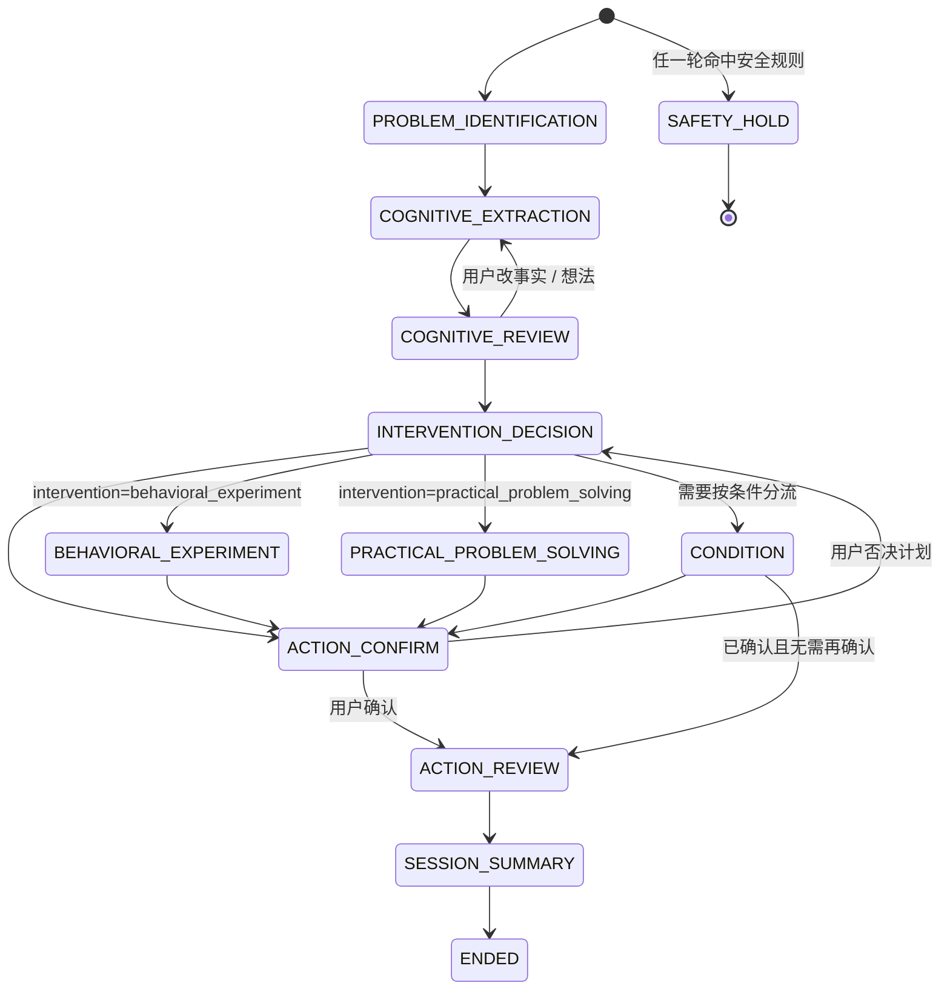

# CBT 状态机

阶段定义与字段见 [流程与状态](../02-架构/02-流程与状态.md)；本文只规定**哪些转移允许、哪些必须拒绝**。

## 1. 允许的转移

## 2. 五条规则

1. **不允许跳阶段。** 用户在"情境"直接问"我该怎么办"，系统回答"先定位一个具体情境"，
   而不是跳到"行动"。
2. **回退只允许回到 `COGNITIVE_EXTRACTION`。** 用户改事实或自动思维时，
   `candidateThought` 必须置空；`userConfirmedThought` 若已确认则标记失效——不能带着旧结论继续。
3. **`ACTION_CONFIRM` 必须显式确认。** "嗯""随便""你定"都不算确认。这是唯一的中断点。
4. **任何阶段都可以被安全分流打断。** 分流在每轮入口重跑，不是只在第一轮跑；
   命中后进入 `SAFETY_HOLD`，后续消息不会把对话拉回普通流程。
5. **阶段切换必须写库。** 运行时快照可以重建，但"用户确认过什么"不能只存在快照里。

## 3. 确认的语义

| 用户动作 | 系统行为 |
|-|-|
| 点"就这样" | 写 `userConfirmedThought` 与 `actionPlan`，进入 `ACTION_REVIEW` |
| 点"再改改" | 允许带修改后的说法重入确认；候选字段更新，确认字段不变 |
| 发普通消息 | 停在 `ACTION_CONFIRM`，返回 `awaiting_confirmation`，不推进 |
| 点"结束" | 进入 `ENDED`，保留已有字段，不补写总结 |

"再改改"曾经是死路——旧版本里 `/confirm` 不接受新说法，用户只能重开一轮。
现在编辑态走同一个接口的可选字段，语义仍是"用户按下才知道生效"。

## 4. 待定

- [ ] `SAFETY_HOLD` 之后是否允许恢复普通流程（当前：不允许，只能重新开一轮）。
  这与安全规则一起定，见 [安全与转介](02-安全与转介.md)。
- [ ] 复盘是否允许跨会话延续。这涉及"行动追踪"需求，属于跨会话疗程的一部分，
  当前没有 `program` 概念。
