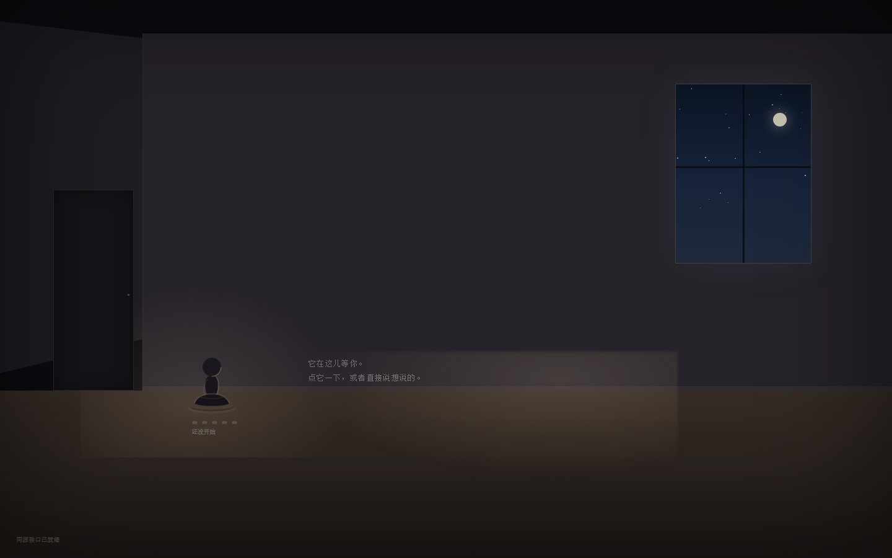
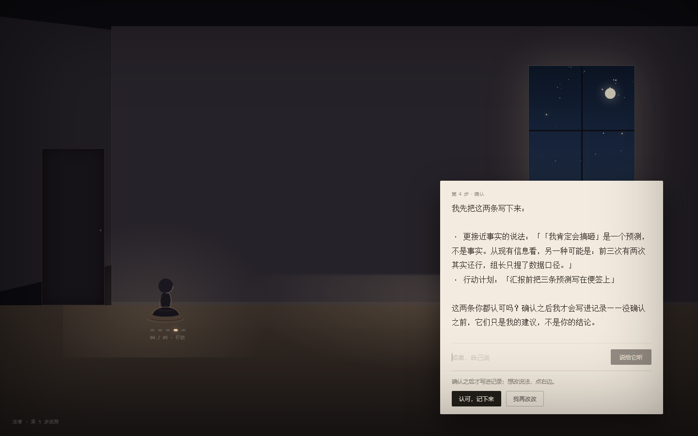
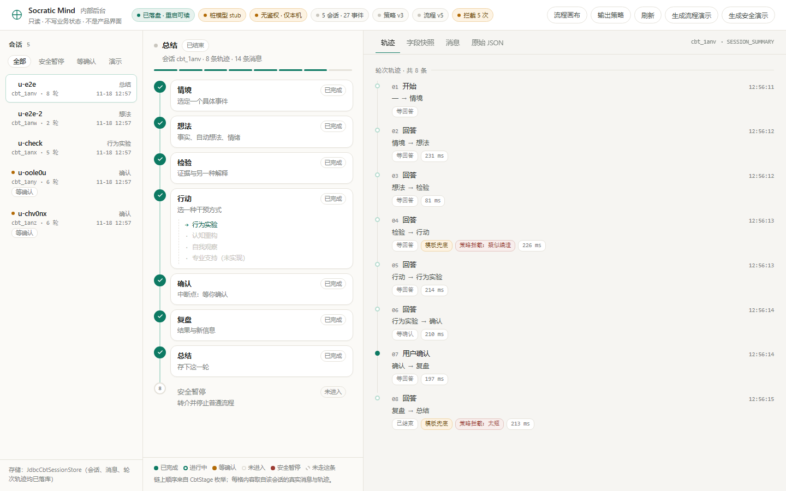
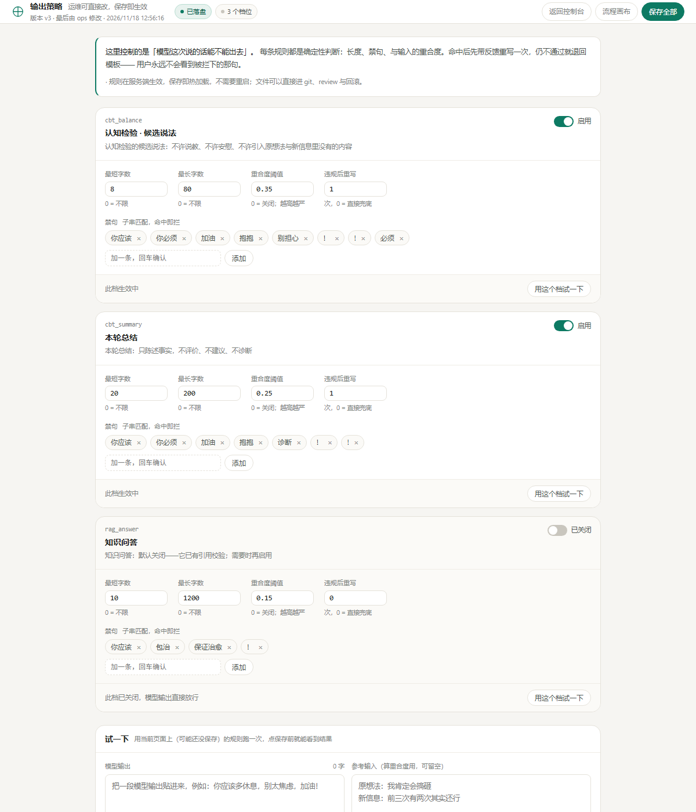
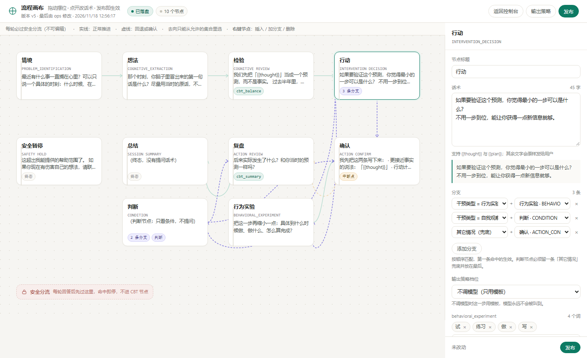

# v0.1.0 全链路验收

验收对象：从**用户在房间里说话**开始，到**运维在后台改策略与流程**，再到**进程重启后记录仍在**。
模型层按约定用**桩**（`psych.ai.provider=stub`），因此本文证明的是**链路与状态**，不证明生成质量。

## 结论

| 段 | 验证内容 | 结果 |
|-|-|-|
| 1 | 用户对话：开场 → 想法 → 检验 → 行动 → 行为实验 → 确认 → 复盘 → 总结 | 通过（8 轮，14 条消息） |
| 2 | 运维调输出策略：新增禁句、保存、验证拦截 | 通过（v2 → v3，命中 `banned`） |
| 3 | 运维改流程话术：发布后新会话立即生效 | 通过（v3 → v4，命中新问法） |
| 4 | 重启存活：杀进程后会话、消息、轨迹仍在 | 通过（详见 [§13](链路验证记录（开发期日志）.md)） |
| 5 | 四个界面可打开、数据来自同一套接口 | 通过（下方截图） |

`mvn -o test`：**69 项全过**；版本已切到 `0.1.0`。

## 1. 用户对话

走的是产品接口 `/api/cbt/*`——房间页调的就是这一组，没有另开后门。

| 轮 | 阶段 | 服务端产出（节选） |
|-|-|-|
| 1 | 情境 | 最近有什么事一直搁在心里？可以只说一个具体的时刻… |
| 2 | 想法 | 那个时刻，你脑子里冒出来的第一句话是什么？ |
| 3 | 检验 | 我们先把「我肯定会搞砸」当成一个预测，而不是事实… |
| 4 | 行动 | 如果要验证这个预测，你觉得最小的一步可以是什么？ |
| 5 | 行为实验 | 把这一步再缩小一点：具体到什么时候做、做什么、怎么算完成？ |
| 6 | 确认 | 我先把这两条写下来：… 这两条你都认可吗？（`awaitingConfirmation=true`） |
| 7 | 复盘 | 用户确认后，`userConfirmedThought` 被写入 |
| 8 | 总结 | `status=ended` |

关键断言（全部成立）：

- 第 6 轮**停住**，普通消息无法推进；必须走 `/confirm`；
- 确认写入的是**用户认可的说法**，与 `candidateThought` 分列两个字段；
- 轨迹 8 条，`guardRule=[null,null,null,"novelty",null,null,null,"min_chars"]`——两次模型调用都被输出策略挡下并退回模板，**拦截留痕可见**；
- 第 5 轮命中了画布上的分支（干预类型=行为实验）。

## 2. 运维调输出策略

```
GET  /api/internal/policy        → 版本 v2
PUT  禁句新增「必须」             → 版本 v3，写入 config/output-policy.json
POST /api/internal/policy/test   → ok=false
     violations=[min_chars, banned, banned, novelty]
```

保存即热加载，不需要重启；拦截同时进轮次轨迹（`guardRule`）与守卫审计。

## 3. 运维改流程话术

```
PUT /api/internal/flow 改「想法」节点话术 → v3 → v4
新开会话第二问 → “E2E 改过的问法：此刻你脑子里冒出的第一句话是什么？”   命中
改回默认话术 → v5
```

证明的是：**画布改的不是文档，是执行**——同一套代码，换个 JSON，用户看到的问题就变了。

## 4. 界面

### 房间（`/`）



### 对话与确认（`/room/?demo=1`）

确认条只在服务端说“需要确认”时出现；左边两颗石子分别对应“行动 / 确认”。



### 窗外（`/room/?view=outside`）

泡泡来自真实会话：大小=轮次，标签=当时的主题，点开读真实消息。


### 内部控制台（`/internal`）

存储徽章已是绿色「已落盘 · 重启可续」；右侧是 8 轮轨迹，第 4、8 轮带「策略拦截」。



### 输出策略（`/internal/policy.html`）



### 流程画布（`/internal/flow.html`）

十个节点、三条分支；右侧是「行动」节点的分支编辑器。



## 5. 本次验收发现并修掉的问题

| 问题 | 表现 | 修法 |
|-|-|-|
| 行动与行为实验重复提问 | 用户会连续两轮看到“最小的一步是什么” | 行为实验改成“再缩小一点：什么时候做、做什么、怎么算完成”（默认值 + 已发布配置同步，v5）；`FlowBranchTest` 断言同步 |

## 已知边界（不影响本次验收结论）

- **PostgreSQL 未实跑**：Docker Hub 拉不动 pgvector 镜像，用 H2 的 PostgreSQL 兼容模式跑同一份 DDL；`application-pg.yml` 已就位。
- 模型层为桩：真实模型的输出质量、延迟、成本未验证。
- 无并发写保护、无数据保留/删除接口、前端仍是单文件原生 JS。

## 复现

```bash
cd backend
mvn -o test                                    # 69 项
java -jar psych-app/target/psych-app-0.1.0.jar \
     --server.port=8099 --spring.profiles.active=h2
# 浏览器打开 http://localhost:8099
```
